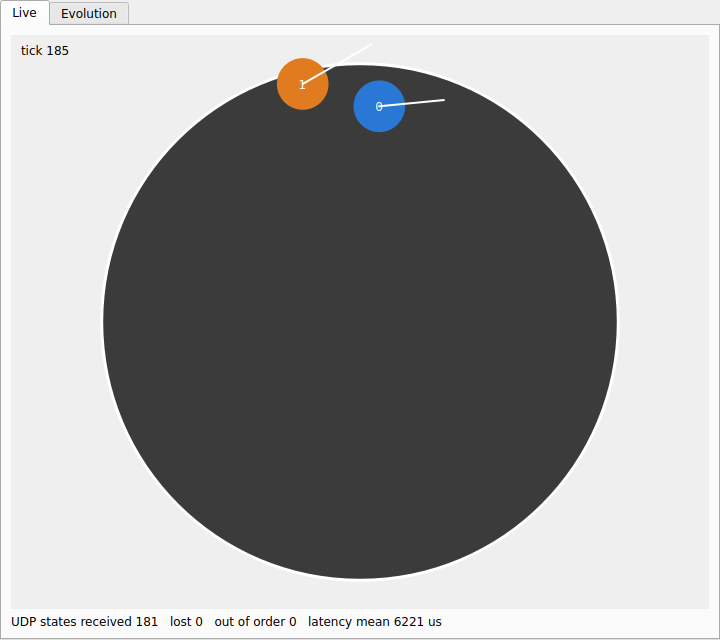
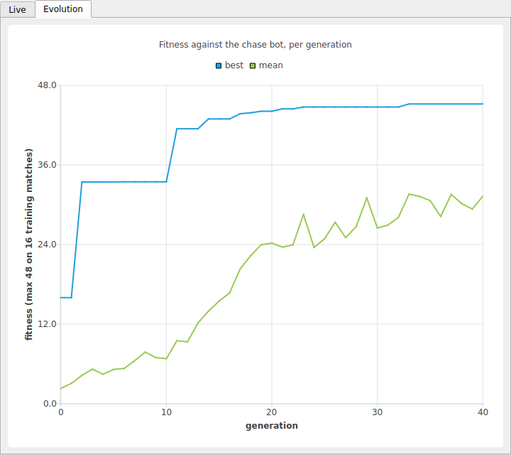

# Arena Evolve

A networked, real-time robot-evolution simulator in C++. Sumo-style robots fight in a 2D arena. Neural-network controllers are evolved with a genetic algorithm, a multi-threaded server runs the simulation at a fixed tick rate, controllers connect over TCP/UDP, and a Qt app shows the arena live.

Inspired by the Arduino sumo robots built with the University of Birmingham Robotics & Drones Team.

## Status

| | Feature | Status |
|---|---|---|
| Simulation | 2D vectors, robots, fixed-timestep loop (headless and real-time) | Done |
| Simulation | Arena, collisions, win conditions | Done |
| Networking | TCP server, binary protocol, controllers as clients | Done |
| Networking | UDP state broadcast, latency measurements | Done |
| Concurrency | Thread per client, simulation thread, thread-safe queues | Done |
| Real-time | Fixed tick rate with deadline-miss and jitter statistics | Done |
| AI | Neural-network controller evolved by a genetic algorithm | Done |
| AI | Parallel fitness evaluation, baseline comparison | Done |
| GUI | Qt live arena view and fitness charts | Done |
| Platform | Hardware map and benchmarks (CPU, memory, disk, network) | Planned |
| Platform | Ubuntu VMs with Vagrant, systemd service, hardened ssh | Planned |
| Platform | Kubernetes (k3d) cluster running the server | Planned |
| Platform | Prometheus, Grafana and alerts for tick latency and node health | Planned |
| Platform | Slurm cluster running neuroevolution as job arrays, scaling study | Planned |
| Platform | Distributed object storage with a node-failure test | Planned |
| Platform | Game days, runbooks and a performance report | Planned |

## Tech stack

- C++20, CMake
- GoogleTest and CTest
- GitHub Actions CI on Linux and Windows, plus Address, Undefined and Thread sanitizer jobs
- Raw POSIX TCP and UDP sockets (Linux), `std::thread`, mutexes and condition variables
- Google Benchmark
- Qt 6 Widgets, Network and Charts (the optional `arena_view` GUI)
- Docker (multi-stage `Dockerfile`, `compose.yaml`) and a Prometheus-format `/metrics` endpoint

Later: VirtualBox and Vagrant, k3d (Kubernetes), Prometheus and Grafana, Slurm, an S3-compatible object store.

## Project structure

```
arena-evolve/
├── src/sim/              # Simulation core: Vec2, Robot, Arena, game loops
├── src/net/              # Protocol, queues, sockets, server, client
├── src/ai/               # Chase bot, neural network, genetic algorithm, thread pool
├── src/gui/              # Qt viewer: live arena over UDP, fitness chart
├── bench/                # Google Benchmark microbenchmarks
├── tests/                # GoogleTest unit tests
├── .github/workflows/    # CI: build and test, plus sanitizers
├── infra/                # Platform lab as code (VMs, Kubernetes, Slurm, storage, monitoring), coming
├── docs/                 # plan.md, packet capture, evolved genomes, later runbooks and reports
├── Dockerfile            # Images: server, bot, fitness worker
├── compose.yaml          # Server + evolved bot + chase bot in containers
├── CMakeLists.txt
├── CLAUDE.md             # Working rules and roadmap
└── SKILLS.md             # Tracker: which skills are really used
```

## Build and test

```bash
cmake -S . -B build -DCMAKE_BUILD_TYPE=Debug
cmake --build build
ctest --test-dir build --output-on-failure
```

Sanitizers (GCC or Clang on Linux):

```bash
cmake -S . -B build -DCMAKE_BUILD_TYPE=Debug -DSANITIZE=thread   # or address, undefined
```

## Run a match

On Linux, after building, start the server, then two controller clients:

```bash
./build/arena_server 5555
./build/arena_bot 127.0.0.1 5555             # chases the other robot
./build/arena_bot 127.0.0.1 5555 --passive   # sits still
./build/arena_watch 127.0.0.1 5555 10        # optional: watch over UDP for 10 s, print loss and latency
```

The server prints the winner and the tick timing after each match.

## Evolve a controller

These work on Linux and Windows (no sockets involved):

```bash
./build/arena_evolve 40 4 1 best.txt         # 40 generations, 4 threads, seed 1, save the best genome
./build/arena_fitness best.txt test          # score a saved genome on the held-out start angles
./build/arena_bot 127.0.0.1 5555 --genome docs/genomes/seed1.txt   # play an evolved genome over TCP
```

How it works:

- **Network.** 8 inputs: own position and velocity, plus the opponent's position and velocity *relative* to the robot. 8 hidden neurons and 2 outputs, all `tanh`. The 2 outputs are the thrust. That's 90 weights in total, and they are the genome. There is no backpropagation: the weights are only ever evolved.
- **Fitness.** The candidate plays the chase bot from 8 start angles, once from each side (16 matches, 20 simulated seconds each, run headless as fast as possible). A win scores 2 plus up to 1 for winning sooner, a draw scores 1, and a loss scores the fraction of the match survived. So any win beats any draw, and even a losing genome gets credit for lasting longer, which gives the search a slope to climb from the start.
- **Genetic algorithm.** Population 64, 2 elites copied unchanged, tournament selection (3 genomes per pick), uniform crossover, and Gaussian mutation (10% of weights, σ = 0.3). One seeded `std::mt19937_64` makes every run reproducible. Elitism plus deterministic matches guarantee that the best fitness never drops (a test checks this).
- **Parallel fitness.** A thread pool (worker threads sharing the existing `ThreadSafeQueue`) scores genomes in parallel. `parallel_for` waits on a C++20 `std::latch`. Each task writes only its own result slot, so nothing else needs a lock. A test checks that parallel and serial results are bit-for-bit identical.
- **Overfitting check.** Training uses 8 start angles. The final results use 16 *different* angles, offset by half a step, which the genome never saw during training.

`arena_evolve` also writes `evolution.csv` (best and mean fitness per generation), which the viewer charts.

## Watch it live (Qt)

`arena_view` is a Qt 6 desktop app. It joins a running server as a UDP watcher, so the server needs no changes. It is built only where Qt 6 is installed (on Ubuntu: `sudo apt install qt6-base-dev qt6-charts-dev`). Under WSL2 its window appears on the Windows desktop through WSLg.

```bash
./build/arena_view 127.0.0.1 5555 --fitness evolution.csv
```

| Live tab | Evolution tab |
|---|---|
|  |  |

- **Live:** the arena as the server broadcasts it. Arrows show velocity. The status line shows UDP states received, lost and out of order, and the mean latency. In the screenshot, the evolved controller (blue) is pushing the chase bot off the top edge at tick 185.
- **Evolution:** the best fitness climbs in steps and never falls (elitism). The mean follows as good genes spread through the population.
- **How it is built:** `QUdpSocket::readyRead` and a 1-second `QTimer` (to renew the Watch lease) are connected to slots, so all networking runs on Qt's event loop with no extra threads. `ArenaWidget` paints with `QPainter`, flipping y because the arena's y points up. The chart uses Qt Charts (`QLineSeries`, `QValueAxis`).
- **Latency as the GUI sees it:** about 6 ms mean, against 0.27 ms for `arena_watch` on the same machine. The GUI timestamps a datagram only when the event loop gets to it, which can be after a repaint, and under WSLg each repaint goes through a compositor. So this number is "time until the GUI noticed", not network latency. For network figures, use `arena_watch`.
- `--screenshot file.png` saves the window after 3 seconds and exits. That is how the images above were made, and how the GUI was checked without anyone looking at it.

## Monitoring: `/metrics` and `/health`

`arena_server` also serves HTTP on a second port (default 8080):

```bash
curl localhost:8080/health     # "ok": the process is up and answering (for liveness probes)
curl localhost:8080/metrics    # Prometheus text format
```

```
arena_matches_total{result="win"} 3
arena_matches_total{result="draw"} 0
arena_ticks_total 634
arena_late_ticks_total 0
arena_watchers 0
arena_match_running 1
arena_last_match_tick_interval_mean_seconds 0.016667875
arena_last_match_tick_jitter_seconds 0.000118907
arena_last_match_lateness_max_seconds 0.000619512
```

- **Threads.** The simulation thread updates the numbers. A separate HTTP thread reads them when scraped. Every field is a `std::atomic` with `memory_order_relaxed`: each number stands alone, so no lock and no stronger ordering is needed, and the tick loop never waits for a scrape.
- **The HTTP part is deliberately tiny.** One connection at a time, `GET` only, `Connection: close`, and a 1-second timeout so a silent client cannot hold the thread. Building the response is a pure function (`net::http_response`) with its own unit tests. A further test scrapes a real `HttpServer` over TCP.
- These are the numbers the platform phase will feed to Prometheus and Grafana, for example an alert on `arena_late_ticks_total` rising.

## Run it in containers (Docker)

One multi-stage [`Dockerfile`](Dockerfile) builds the programs once in a full toolchain image, then copies only the binaries into small runtime images that run as a non-root user:

| Image (`--target`) | Contains | Size |
|---|---|---|
| `server` | `arena_server` | 118 MB |
| `bot` | `arena_bot` + `docs/genomes` | 118 MB |
| `fitness` | `arena_fitness`, `arena_evolve` + genomes | 118 MB |

The three images share the same Ubuntu base layer (about 78 MB of the 118 MB), so on disk they cost little more than one. Tests and benchmarks are switched off in the image build (`-DARENA_BUILD_TESTS=OFF`), so it downloads nothing.

[`compose.yaml`](compose.yaml) runs the server plus an evolved bot and a chase bot that play match after match (`restart: always` brings a bot back when its match ends). Measured with `docker compose up` on the development laptop:

- `/health` returns 200. After 12 seconds, `/metrics` showed 3 matches won, 0 drawn, 634 ticks and 0 late ticks, with 0.12 ms jitter.
- `arena_watch` on the host, going through Docker's UDP port mapping, received 189 of 189 states. Mean latency was 0.51 ms, compared with 0.27 ms without Docker: the extra hop through Docker's port forwarding.
- `docker run --rm arena-evolve/fitness` prints `fitness 90.2783 wins 32 draws 0 losses 0`, the same score as the native run, so the fitness worker gives identical results in a container.

## Design decisions

### Why raw POSIX sockets (Linux-only server)

The server uses `socket`, `bind`, `listen`, `accept`, `recv` and `send` directly instead of Boost.Asio.

- **Visibility.** Every network step is in the code: byte order, partial sends, `TCP_NODELAY`, `SIGPIPE`, `SO_REUSEADDR`, shutting a socket down to wake a blocked thread. A library would hide exactly the parts this project exists to show.
- **Simple threading.** One reader and one writer thread per client, with blocking calls, is easy to follow. Asio's asynchronous callback style is more scalable but harder to reason about.
- **The cost is portability.** The server and client build only on Linux. That matches where they run: WSL2, Docker and the Linux lab. The simulation core, protocol, queues and controllers have no socket code, so they still build and are tested on Windows in CI.
- **When this would change.** Thousands of clients would need non-blocking I/O with `epoll` (or Asio) instead of two threads per client. A match has two clients.

### Server threads

| Thread | Does | Talks to others through |
|---|---|---|
| Simulation (one) | Real-time tick loop; the only thread that touches the arena | Pops commands from a `ThreadSafeQueue`; puts states into each client's `Mailbox` |
| Reader (one per client) | Turns incoming bytes into commands | Pushes into the shared `ThreadSafeQueue` |
| Writer (one per client) | Sends the latest state | Takes from its `Mailbox`, which keeps only the newest state, so a slow client never delays the tick loop |

## Results

Measured on 2026-11-16 on the development laptop: 4 cores at 2.4 GHz, WSL2 Ubuntu 26.04, g++ 15.2, Release build. Single runs, so treat them as indicative, not as averages over many sessions.

### Real-time tick loop (one match, 60 ticks per second, 156 ticks)

| Measure | Value |
|---|---|
| Target tick interval | 16 667 µs |
| Mean interval | 16 665 µs |
| Jitter (standard deviation of the interval) | 102 µs (0.6% of a tick) |
| Shortest / longest interval | 16 355 / 16 990 µs |
| Wake-up lateness, mean / max | 301 / 617 µs |
| Ticks that started after their deadline | 0 |

The mean interval matches the target because each deadline is computed from the start time (`start + n * period`), so lateness never adds up into drift. Wake-up lateness of about 0.3 ms is the OS scheduler and timer slack in a WSL2 virtual machine. It is under 4% of the tick budget.

### UDP state broadcast (same match, `arena_watch` on the same machine)

| Measure | Value |
|---|---|
| State datagrams received | 156 of 156 |
| Lost / out of order | 0 / 0 |
| One-way latency, mean (stddev) | 268 µs (106 µs) |
| One-way latency, min / max | 120 / 807 µs |

Latency is measured with the system-wide monotonic clock on both ends, so it is only valid on one machine. Over localhost no packets were lost. Loss would show up on a real network or under `tc netem` (planned for the game days).

### Microbenchmarks (Google Benchmark, `sim_bench`, mean of 3 runs)

| Benchmark | Time per call |
|---|---|
| `sim::step`, 2 robots (a real match) | 10.4 ns |
| `sim::step`, 8 / 16 / 32 / 64 robots | 72 ns / 261 ns / 973 ns / 3.5 µs |
| Fitted complexity of `sim::step` | O(N²), RMS error 9% |
| Encode a 2-robot State | 138 ns |
| Decode a 2-robot State | 54 ns |

One physics step for a match takes about 10 ns of a 16.7 ms tick, so the server spends almost all of each tick asleep. The all-pairs collision check grows as N², as expected. It would only matter with hundreds of robots, and a spatial grid would fix it then. Encoding is slower than decoding because it builds the payload in a second vector and then copies it into the frame.

### Neuroevolution vs the chase bot

`arena_evolve 40 4 <seed>`: 40 generations of 64 genomes, about 1.2 s per run on 4 threads. Results on the 16 held-out start angles × 2 sides = 32 matches:

| Controller | Wins | Draws | Losses |
|---|---|---|---|
| Random genome (generation 0) | 0 | 0 | 32 |
| Chase bot vs itself | 0 | 32 | 0 |
| **Evolved, seed 1** ([`docs/genomes/seed1.txt`](docs/genomes/seed1.txt)) | **32** | 0 | 0 |
| Evolved, seeds 2 / 3 / 4 / 5 | 32 / 30 / 20 / 32 | 0 | 0 / 2 / 12 / 0 |

- Two chase bots always draw: they meet head-on, bounce apart and repeat until time runs out. A random network drives itself out of the ring.
- Four of the five seeds produce a controller that beats the baseline on almost every unseen start. Seed 4 reached high *training* fitness but won only 20 of 32 unseen matches. It partly memorised its 8 training openings, which is exactly what the held-out angles are there to catch. More training angles, or a fresh random set each generation, would be the next thing to try.
- Seed 1's best training fitness went 16.0 (all draws) → 33.4 (generation 2, first wins) → 45.2 (generation 33), out of a maximum of 48.
- Over the real TCP server (commands one tick late, positions sent as 32-bit floats), the seed 1 genome beat the networked chase bot in 3 of 3 matches.

### Parallel fitness evaluation (thread pool)

One generation (64 genomes × 16 matches), averaged over 3 repeats:

| Threads | Time | Speed-up |
|---|---|---|
| 1 | 81.4 ms | 1.00× |
| 2 | 41.7 ms | 1.95× |
| 4 | 28.2 ms | 2.88× |

The jump from 1 to 2 threads is almost perfect, because matches are independent and share no data. From 2 to 4 threads the gain shrinks: WSL is capped at 4 logical CPUs, the laptop's other work competes for them, and the last tasks in each generation leave some threads idle. This is the workload the platform phase will spread across Slurm workers for a proper scaling study.

### Profiling with `perf` (a hypothesis that turned out wrong)

`perf record` on `sim_bench` (64 robots) put 99.9% of samples in `sim::step`, and `perf annotate` put about 90% on the all-pairs overlap test around the `sqrtsd` (square root) instruction. Hypothesis: most pairs are far apart, so comparing squared distances first and skipping the square root should make the step clearly faster.

Measured with `perf stat` (hardware counters work inside WSL2) and Google Benchmark, 5 repetitions:

| 64 robots, per step | Before | After |
|---|---|---|
| Time | 3391 ns | 3257 ns (−4%, inside run-to-run noise) |
| Instructions | ≈58 400 | ≈58 380 |
| Instructions per cycle | 3.7 | 3.9 |

The hypothesis was wrong. The CPU was already running nearly 4 instructions per cycle. The "not overlapping" branch is almost always predicted correctly, so the out-of-order core never waits for the square root: it starts the next pair while the root is still being computed. `perf annotate` blames `sqrtsd` because samples land on the slow instruction and the ones just after it, not because the program is stalled there. The real cost is about 29 instructions of plain loop work per pair. The change was reverted to keep the code simple. If this ever matters (hundreds of robots), the fix is fewer pairs (a spatial grid), not a cheaper pair test.

### The protocol on the wire (`tcpdump` and `tshark`)

[`docs/captures/match.pcap`](docs/captures/match.pcap) is one complete match captured on loopback: two TCP controllers and one UDP watcher. Open it in Wireshark, or summarise it with `tshark`:

| Traffic | Packets | Payload size |
|---|---|---|
| TCP connects (SYN) | 2 | |
| Welcome, server → each client | 2 | 4 bytes |
| State over TCP, server → clients | 312 (156 ticks × 2 clients) | 50 bytes |
| Command, chaser → server (the passive bot sends none) | 156 | 11 bytes |
| TCP packets with no payload (handshakes, ACKs, close) | 173 | 0 |
| Watch over UDP, watcher → server (once a second) | 4 | 3 bytes |
| State over UDP, server → watcher | 156 | 50 bytes |

Decoding the first State byte by byte matches the documented format exactly:

```
03                  type 3 = State
00 2f               payload length 47 = 13 + 2 robots × 17
00 00 00 01         tick 1
00 00 06 18 39 c1 71 19   sent_at_ns (steady_clock)
02                  2 robots
bf 00 00 00  00 00 00 00  00 00 00 00  00 00 00 00  01    robot 0: x = -0.5, y = 0, vx = 0, vy = 0, in ring
3f 00 00 00  00 00 00 00  00 00 00 00  00 00 00 00  01    robot 1: x = +0.5, ...
```

The first Command is `02 0008 3f800000 00000000`: thrust (1.0, 0.0), the chaser driving straight at its opponent.

Two things the capture shows that the code alone does not:

- **UDP timing seen from outside.** UDP States leave the server every 16.669 ms on average, with a standard deviation of 0.21 ms, matching the server's own jitter numbers.
- **The cost of TCP's reliability.** More than a quarter of the TCP packets (173 of 643) carry no data at all: they are acknowledgements and connection setup and teardown. The UDP stream needs none of that. It loses nothing on localhost, but on a lossy network it would just skip a state instead of stalling the stream.

To reproduce: run `sudo tcpdump -i lo -w match.pcap port 5555` while a match plays.
