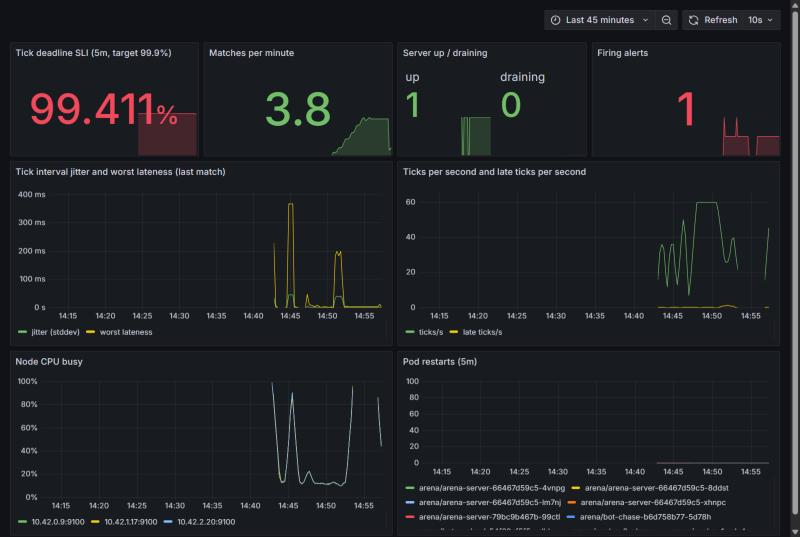

# D3: telemetry

Metrics, dashboards and alerts for the Kubernetes lab, all as code, with no Helm, so every line is readable.

```bash
make monitoring-up            # deploy into the D2 cluster
bash infra/d3/verify.sh       # targets, SLI, and two experiments that make alerts fire (~8 min)
kubectl -n monitoring port-forward svc/grafana 3000    # then http://localhost:3000
```



## Components

| Component | What it does | Defined in |
|---|---|---|
| `arena_server` `/metrics` | Game counters and tick timing, written by the simulation thread as `std::atomic` values | `src/net/metrics.cpp` (D5 of the app) |
| node-exporter (DaemonSet) | CPU, memory, disk and network of every node | `infra/d3/k8s/monitoring.yaml` |
| kube-state-metrics | State of Kubernetes objects: pods, restarts, deployments, jobs. Read-only ClusterRole | same |
| Prometheus | Scrapes everything every 5 s and evaluates the rules | `prometheus-config.yaml` |
| Alertmanager | Receives firing alerts, groups them and routes them (API and UI only in the lab) | `monitoring.yaml` |
| Grafana | Data source and dashboard provisioned from files, anonymous read-only viewer | `monitoring.yaml`, [`dashboards/arena.json`](../infra/d3/dashboards/arena.json) |

Discovery without Kubernetes API access: node-exporter sits behind a *headless* Service, so the DNS name `node-exporter.monitoring.svc` returns one A record per pod, and Prometheus's `dns_sd_configs` finds every node that way.

## SLO

- **SLI:** the share of ticks that start on time (the loop reached the tick before its deadline passed):
  `arena:tick_on_time:ratio_rate5m = 1 - rate(arena_late_ticks_total[5m]) / rate(arena_ticks_total[5m])`
- **SLO:** 99.9% over 5 minutes, at 60 ticks per second. That allows about 18 late ticks in 5 minutes.
- **Alert:** `ArenaTickDeadlineSLOBreached` fires if the SLI stays below 0.999 for 1 minute.

Other alerts: `ArenaServerDown` (scrape fails for 30 s), `ArenaNoMatchesFinishing`, `PodRestarting`, `NodeMemoryLow`. Each alert's annotation links to a runbook in `docs/runbooks/` (written in D6).

## Results

All 6 scrape targets were up: Prometheus, kube-state-metrics, the arena server, and node-exporter on 3 nodes.

| Experiment | Alert | Time to reach Alertmanager |
|---|---|---|
| `kubectl scale deployment/arena-server --replicas=0` | `ArenaServerDown` | 45 s (30 s `for:` plus scrape and evaluation) |
| Server CPU limit set to 5 millicores | `ArenaTickDeadlineSLOBreached` | 80 s; worst wake-up lateness **100 ms** |

**100 ms is exactly one CFS period.** A CPU limit is enforced by the kernel's Completely Fair Scheduler as a quota per 100 ms period. Once the container uses up 0.5 ms in a period, every thread in it waits for the next period. So the tick loop doesn't run slightly slower: it stops dead for up to 100 ms at a time. That's why CPU limits are risky for latency-sensitive services, and why many teams use requests without limits for them.

**A real finding the alert caught before any experiment:** the SLO alert was already firing when the checks started. The server pod had 264 late ticks. Their timing matched the evolution Job (4 CPU-heavy pods, D2) and the monitoring stack starting up, all on the same 4 vCPUs. The server requests only 0.1 CPU, so under contention the scheduler gave the batch pods the CPU. That's a noisy-neighbour effect. Once the Job finished, late ticks fell to about 2 a minute, inside the SLO. Possible fixes: a higher CPU request (or a Guaranteed QoS class) for the server, a PriorityClass, or keeping batch work on separate nodes with taints and tolerations. These are compared in the D7 performance report.
